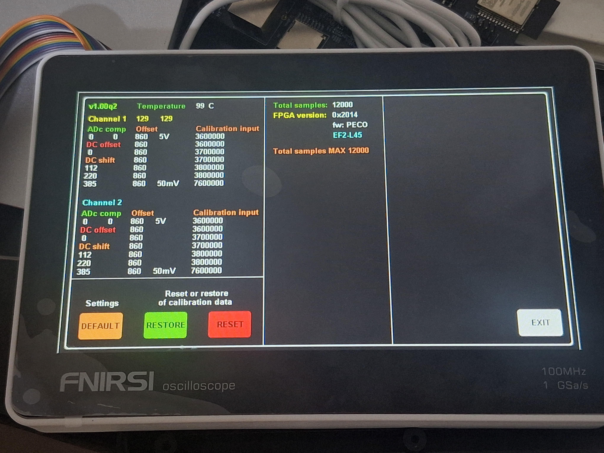
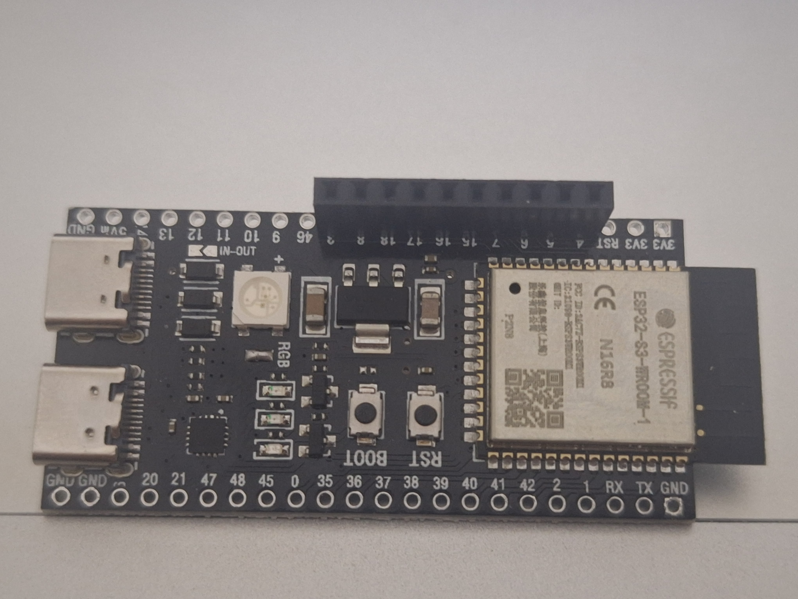
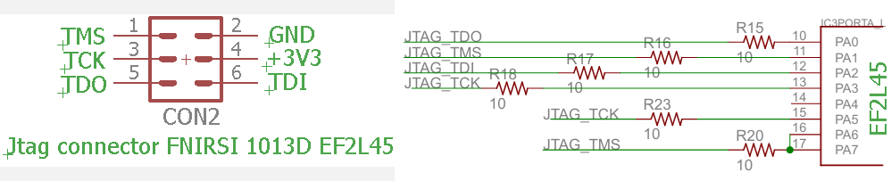
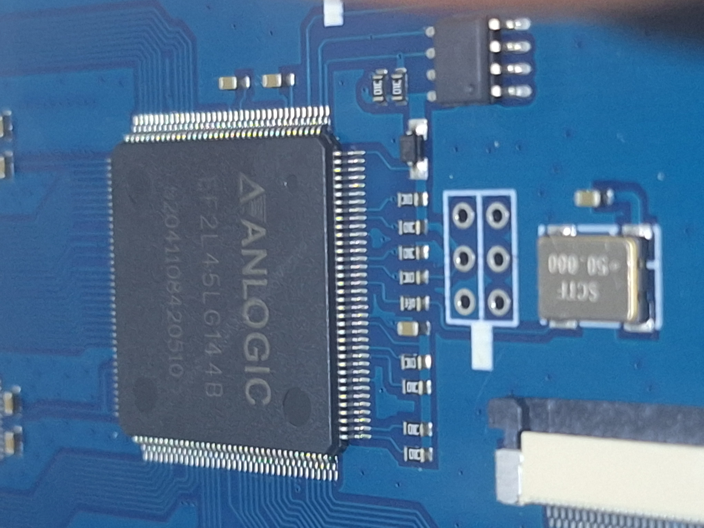
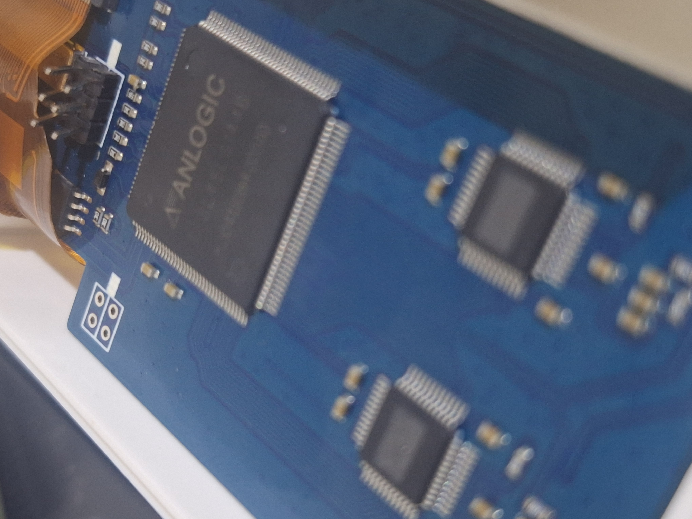
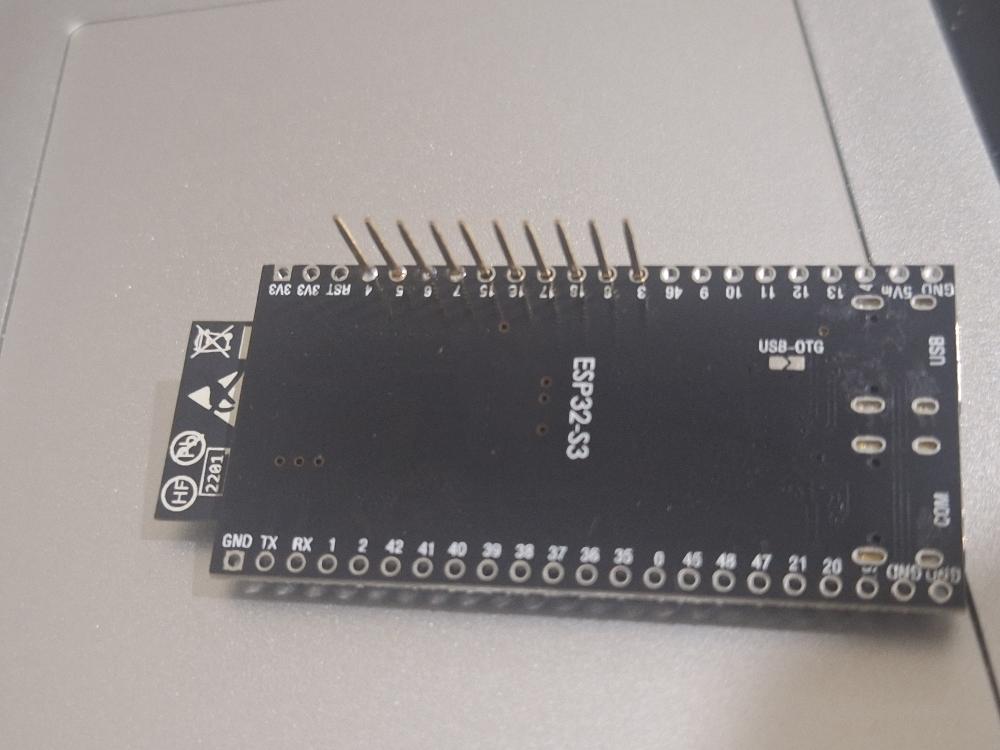
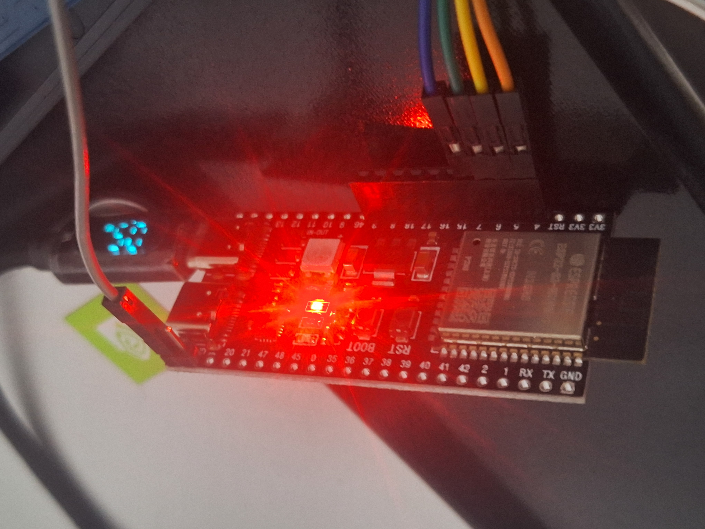
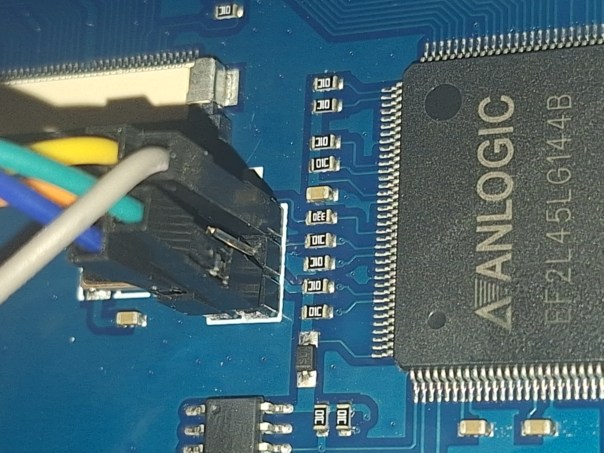

# ESP32_FPGA_Updater

Use an **ESP32-S3** as a USB-JTAG adapter to back up and reflash the **Anlogic EF2L45** FPGA in the **FNIRSI 1013D** oscilloscope with [openFPGALoader](https://github.com/trabucayre/openFPGALoader).



---

## Table of Contents

- [Hardware](#hardware)
  - [ESP32-S3](#esp32-s3)
  - [How it works](#how-it-works)
  - [Wiring](#wiring)
- [Software](#software)
  - [Firmware build & upload](#firmware-build--upload)
  - [FPGA firmware (ALL18 / FPGA2014)](#fpga-firmware-all18--fpga2014)
- [openFPGALoader](#openfpgaloader)
  - [Clone & patch](#clone--patch)
  - [Dependencies](#dependencies)
  - [Build](#build)
  - [Usage](#usage)
- [Troubleshooting](#troubleshooting)
- [Credits](#credits)

---

## Hardware

### ESP32-S3

I use an **ESP32-S3-WROOM-1 N16R8** on an **ESP32-S3-DevKitC-1** board.



> **Which other ESP32 boards could be used? S2/C3/C6/mini/zero/etc.?**
>
> - The firmware needs the **USB Serial/JTAG controller** (`soc/usb_serial_jtag_reg.h`) with the **JTAG bridge to GPIO** feature.
> - **ESP32 (classic)** and **ESP32-S2** do **not** have this controller, so they won't work.
> - **ESP32-C3 / C6 / H2** have a USB Serial/JTAG controller but are **untested**. Check that `USB_SERIAL_JTAG_USB_JTAG_BRIDGE_EN` and the `USB_JTAG_*_IDX` signals exist in their headers. Pin numbers must be adapted.
> - Any **ESP32-S3** board (mini, zero, etc.) should work, as long as GPIO 4–7 are available or remapped.

### How it works

It uses the Espressif headers `soc/usb_serial_jtag_reg.h` and `soc/gpio_sig_map.h`, based on [emard's firmware](https://github.com/emard).

| Description | emard's firmware |
| --- | --- |
| How it works | Uses the ESP32-S3's built-in hardware USB-JTAG controller |
| Who handles the JTAG commands | The chip's silicon |
| USB ID | `303a:1001` (Espressif) |
| openFPGALoader cable | `-c esp32s3` |
| Speed | About 2 Mbit/s or more |

### Wiring

| ESP32 GPIO | Signal | EF2L45 (CON2/JTAG) pin |
| :---: | :---: | :---: |
| 4 | TCK | 3 |
| 5 | TMS | 1 |
| 6 | TDI | 6 |
| 7 | TDO | 5 |
| GND | GND | 2 |
| – | 3V3 | 4 |

> [!WARNING]
> **Do not connect 3.3 V between the ESP32 and the FPGA JTAG header.** Power the oscilloscope by itself and connect **GND only**.

**CON2 pinout (FNIRSI 1013D schematic):**



| CON2 on the board | EF2L45 + CON2 |
| :---: | :---: |
|  |  |

| ESP32 pins | ESP32 wired | EF2L45 wired |
| :---: | :---: | :---: |
|  |  |  |

---

## Software

- **VSCodium** 1.143.17232
- **pioarduino IDE** extension 1.4.7

### Project structure

```text
./
├── assets/                              # pictures used in this README
├── openfpgaloader_juniorpolegato.patch  # openFPGALoader patch (EF2L45 + raw .bin)
├── platformio.ini
└── src/
    └── main.cpp                         # ESP32-S3 USB-JTAG bridge firmware
```

<details>
<summary><b>platformio.ini</b></summary>

```ini
[env:esp32s3]
platform = espressif32
board = esp32-s3-devkitc-1
framework = arduino

; N16R8: 16MB QIO flash + 8MB OPI PSRAM
board_build.arduino.memory_type = qio_opi
board_build.flash_mode = qio
board_build.psram_type = opi
board_upload.flash_size = 16MB
board_upload.maximum_size = 16777216
board_build.partitions = default_16MB.csv

build_flags =
    -DBOARD_HAS_PSRAM
    -DARDUINO_USB_MODE=1
    -DARDUINO_USB_CDC_ON_BOOT=1
```
</details>

<details>
<summary><b>src/main.cpp</b></summary>

```cpp
// Tools -> USB Mode: Hardware CDC and JTAG
// Tools -> USB CDC On Boot: Enabled
// Tools -> JTAG Adapter: Integrated USB JTAG
#include <Arduino.h>
#include "soc/usb_serial_jtag_reg.h"
#include "soc/gpio_sig_map.h"

#define PIN_TCK 4
#define PIN_TMS 5
#define PIN_TDI 6
#define PIN_TDO 7

static bool was_conn = false;

static void route(){
  pinMode(PIN_TCK, OUTPUT); pinMode(PIN_TMS, OUTPUT);
  pinMode(PIN_TDI, OUTPUT); pinMode(PIN_TDO, INPUT);
  WRITE_PERI_REG(USB_SERIAL_JTAG_CONF0_REG,
    READ_PERI_REG(USB_SERIAL_JTAG_CONF0_REG) | USB_SERIAL_JTAG_USB_JTAG_BRIDGE_EN);
  esp_rom_gpio_connect_out_signal(PIN_TCK, USB_JTAG_TCK_IDX, false, false);
  esp_rom_gpio_connect_out_signal(PIN_TMS, USB_JTAG_TMS_IDX, false, false);
  esp_rom_gpio_connect_out_signal(PIN_TDI, USB_JTAG_TDI_IDX, false, false);
  esp_rom_gpio_connect_in_signal (PIN_TDO, USB_JTAG_TDO_BRIDGE_IDX, false);
}

static void unroute(){
  WRITE_PERI_REG(USB_SERIAL_JTAG_CONF0_REG,
    READ_PERI_REG(USB_SERIAL_JTAG_CONF0_REG) & ~USB_SERIAL_JTAG_USB_JTAG_BRIDGE_EN);
  pinMode(PIN_TCK, INPUT); pinMode(PIN_TMS, INPUT);
  pinMode(PIN_TDI, INPUT); pinMode(PIN_TDO, INPUT);
}

void setup(){ Serial.begin(); }

void loop(){
  bool c = usb_serial_jtag_is_connected();
  if (!was_conn && c) route();
  if (was_conn && !c) unroute();
  was_conn = c;
}
```
</details>

### Firmware build & upload

1. Plug the USB cable into the ESP32's **COM** USB-C port.
2. Find the serial port on Linux (or Windows) and replace `/dev/ttyACM0` with it:

   ```bash
   ~/.platformio/penv/bin/pio run -e esp32s3 -t upload --port /dev/ttyACM0
   ```

3. Unplug from **COM** and plug into the **USB** port.
4. Check that it was detected:

   ```console
   $ lsusb | grep Espressif
   Bus 001 Device 012: ID 303a:1001 Espressif USB JTAG/serial debug unit
   ```

### FPGA firmware (ALL18 / FPGA2014)

- Download ALL18 with FPGA2014 from the [EEVblog thread](https://www.eevblog.com/forum/testgear/fnirsi-1013d-100mhz-tablet-oscilloscope/msg6262084/#msg6262084).
- Thanks to **Atlan** and the members of that forum.

---

## openFPGALoader

### Clone & patch

```console
$ git clone https://github.com/trabucayre/openFPGALoader
Cloning into 'openFPGALoader'...
remote: Enumerating objects: 11503, done.
remote: Counting objects: 100% (309/309), done.
remote: Compressing objects: 100% (160/160), done.
remote: Total 11503 (delta 212), reused 177 (delta 149), pack-reused 11194 (from 3)
Receiving objects: 100% (11503/11503), 44.71 MiB | 5.69 MiB/s, done.
Resolving deltas: 100% (8085/8085), done.

$ cd openFPGALoader

$ patch -p1 < ../openfpgaloader_juniorpolegato.patch
patching file src/anlogic.cpp
patching file src/part.hpp
```

The patch does two things:

- **`src/part.hpp`** adds the **EF2L45** IDCODE `0x03004c37`.
- **`src/anlogic.cpp`** allows writing raw **`.bin`/`.raw`** files to flash (`--file-type bin -f`).

<details>
<summary><b>openfpgaloader_juniorpolegato.patch</b></summary>

```diff
diff --git a/src/anlogic.cpp b/src/anlogic.cpp
index 064397b..ba1a910 100644
--- a/src/anlogic.cpp
+++ b/src/anlogic.cpp
@@ -14,6 +14,7 @@
 #include "display.hpp"
 #include "progressBar.hpp"
 #include "spiFlash.hpp"
+#include "rawParser.hpp"

 #define REFRESH      0x01
 #define IDCODE       0x06
@@ -64,24 +65,34 @@ void Anlogic::program(unsigned int offset, bool unprotect_flash)
 	if (_mode == Device::NONE_MODE)
 		return;

-	AnlogicBitParser bit(_filename, (_mode == Device::MEM_MODE), _verbose);
+	ConfigBitstreamParser *bit;
+	if (_file_extension == "bin" || _file_extension == "raw") {
+		if (_mode == Device::MEM_MODE) {
+			printError("raw/bin files are only supported for flash (-f)");
+			return;
+		}
+		bit = new RawParser(_filename, false);
+	} else {
+		bit = new AnlogicBitParser(_filename, (_mode == Device::MEM_MODE), _verbose);
+	}

 	printInfo("Parse file ", false);
-	if (bit.parse() == EXIT_FAILURE) {
+	if (bit->parse() == EXIT_FAILURE) {
 		printError("FAIL");
+		delete bit;
 		return;
 	}
-
 	printSuccess("DONE");

 	if (_verbose)
-		bit.displayHeader();
+		bit->displayHeader();

-	const uint8_t *data = bit.getData();
-	int len = bit.getLength() / 8;
+	const uint8_t *data = bit->getData();
+	int len = bit->getLength() / 8;

 	if (_mode == Device::SPI_MODE) {
 		FlashInterface::write(offset, data, len, unprotect_flash);
+		delete bit;
 		return;
 	}

@@ -137,6 +148,7 @@ void Anlogic::program(unsigned int offset, bool unprotect_flash)
 		_jtag->shiftIR(BYPASS, IRLENGTH);
 		_jtag->toggleClk(15);
 	}
+	delete bit;
 }

 uint32_t Anlogic::idCode()
diff --git a/src/part.hpp b/src/part.hpp
index b7d0781..482acfc 100644
--- a/src/part.hpp
+++ b/src/part.hpp
@@ -28,6 +28,7 @@ static std::map <uint32_t, fpga_model> fpga_list = {
 	{0x0a014c35, {"anlogic", "eagle s20", "EG4S20BG256", 8}},

 	/* Anlogic Elf2 */
+	{0x03004c37, {"anlogic", "elf2",      "EF2L45", 8}},
 	{0x00004c37, {"anlogic", "elf2",      "EF2M45", 8}},

 	/**************************************************************************/
```
</details>

### Dependencies

```bash
sudo apt update
sudo apt install libftdi1-dev libusb-1.0-0-dev libhidapi-dev zlib1g-dev pkg-config libgpiod-dev
```

### Build

```bash
rm -rf build && mkdir build && cd build
cmake .. -DCMAKE_POLICY_VERSION_MINIMUM=3.5
make -j$(nproc)
```

```console
$ ./openFPGALoader --version
openFPGALoader v1.2.0
```

### Usage

> Wire the ESP32 to the EF2L45 first (see [Wiring](#wiring)).

#### 1. Detect the FPGA

```console
$ ./openFPGALoader -c esp32s3 --detect -v --freq 100k
Open Success with vid: 0x303a pid 0x1001
0x1 0xa 0x1 0x8 0x40 0x1f 0x1 0x0 0xff 0x0
esp_usb_jtag: Device found. Base speed 40000 KHz, div range 1 to 255
Jtag frequency : requested 100000Hz -> real 100000Hz divisor=400
found 1 devices
index 0:
        idcode 0x3004c37
        manufacturer anlogic
        family elf2
        model  EF2L45
        irlength 8
```

#### 2. Back up the flash (512 KB)

> [!IMPORTANT]
> **Always make a backup before writing anything.**

```console
$ ./openFPGALoader -c esp32s3 --freq 100k --dump-flash --file-size 524288 backup_1013d.bin
Open Success with vid: 0x303a pid 0x1001
0x1 0xa 0x1 0x8 0x40 0x1f 0x1 0x0 0xff 0x0
esp_usb_jtag: Device found. Base speed 40000 KHz, div range 1 to 255
Jtag frequency : requested 100000Hz -> real 100000Hz divisor=400
Detail:
Jedec ID          : c8
memory type       : 42
memory capacity   : 13
dump flash (May take time)
Open dump file DONE
Read flash : [==================================================] 100.00%
Done
```

#### 3. Restore a backup (`.bin`)

```bash
./openFPGALoader -c esp32s3 --freq 100k --file-type bin -f backup_1013d.bin
```

#### 4. Verify

```bash
./openFPGALoader -c esp32s3 --freq 100k --dump-flash --file-size 524288 verify.bin
cmp verify.bin backup_1013d.bin && echo OK
```

#### 5. Write the new FPGA firmware (`.bit`)

```console
$ ./openFPGALoader -c esp32s3 --freq 100k -f /tmp/new\ FPGA\ firmware\ with\ ALL18\ for\ EF2\ and\ AL3\ FPGA/FPGA2014.bit
write to flash
Open Success with vid: 0x303a pid 0x1001
0x1 0xa 0x1 0x8 0x40 0x1f 0x1 0x0 0xff 0x0
esp_usb_jtag: Device found. Base speed 40000 KHz, div range 1 to 255
Jtag frequency : requested 100000Hz -> real 100000Hz divisor=400
Parse file header end
DONE
Detail:
Jedec ID          : c8
memory type       : 42
memory capacity   : 13
flash chip unknown: use basic protection detection
start addr: 00000000, end_addr: 00030000
Erasing: [==================================================] 100.00%
Done
Writing: [==================================================] 100.00%
Done
```

Result: **FPGA version 0x2014, EF2-L45** 🎉


---

## Troubleshooting

Sometimes writing fails or the readback doesn't match, probably because of wiring or noise. **Repeat the write and verify steps until `cmp` prints `OK`.** Short wires and a solid GND help.

<details>
<summary><b>Full log: write timeout → mismatches → success</b></summary>

**Write #1: timeout at 2.29%**

```console
$ ./openFPGALoader -c esp32s3 --freq 100k --file-type bin -f backup_1013d.bin
write to flash
Open Success with vid: 0x303a pid 0x1001
0x1 0xa 0x1 0x8 0x40 0x1f 0x1 0x0 0xff 0x0
esp_usb_jtag: Device found. Base speed 40000 KHz, div range 1 to 255
Jtag frequency : requested 100000Hz -> real 100000Hz divisor=400
Parse file DONE
Detail:
Jedec ID          : c8
memory type       : 42
memory capacity   : 13
flash chip unknown: use basic protection detection
start addr: 00000000, end_addr: 00080000
Erasing: [==================================================] 100.00%
Done
Writing: [==                                                ] 2.29%timeout: 64 37 4c
64
wait: Error
write en: Error
```

**Write #2: OK**

```console
$ ./openFPGALoader -c esp32s3 --freq 100k --file-type bin -f backup_1013d.bin
write to flash
Open Success with vid: 0x303a pid 0x1001
0x1 0xa 0x1 0x8 0x40 0x1f 0x1 0x0 0xff 0x0
esp_usb_jtag: Device found. Base speed 40000 KHz, div range 1 to 255
Jtag frequency : requested 100000Hz -> real 100000Hz divisor=400
Parse file DONE
Detail:
Jedec ID          : c8
memory type       : 42
memory capacity   : 13
flash chip unknown: use basic protection detection
start addr: 00000000, end_addr: 00080000
Erasing: [==================================================] 100.00%
Done
Writing: [==================================================] 100.00%
Done
```

**Verify #1: differ**

```console
$ ./openFPGALoader -c esp32s3 --freq 100k --dump-flash --file-size 524288 verify.bin
Open Success with vid: 0x303a pid 0x1001
0x1 0xa 0x1 0x8 0x40 0x1f 0x1 0x0 0xff 0x0
esp_usb_jtag: Device found. Base speed 40000 KHz, div range 1 to 255
Jtag frequency : requested 100000Hz -> real 100000Hz divisor=400
Detail:
Jedec ID          : c8
memory type       : 42
memory capacity   : 13
dump flash (May take time)
Open dump file DONE
Read flash : [==================================================] 100.00%
Done

$ cmp verify.bin backup_1013d.bin && echo OK
verify.bin backup_1013d.bin differ: byte 501070, line 191
```

**Verify #2: differ**

```console
$ ./openFPGALoader -c esp32s3 --freq 100k --dump-flash --file-size 524288 verify.bin
Open Success with vid: 0x303a pid 0x1001
0x1 0xa 0x1 0x8 0x40 0x1f 0x1 0x0 0xff 0x0
esp_usb_jtag: Device found. Base speed 40000 KHz, div range 1 to 255
Jtag frequency : requested 100000Hz -> real 100000Hz divisor=400
Detail:
Jedec ID          : c8
memory type       : 42
memory capacity   : 13
dump flash (May take time)
Open dump file DONE
Read flash : [==================================================] 100.00%
Done

$ cmp verify.bin backup_1013d.bin && echo OK
verify.bin backup_1013d.bin differ: byte 354681, line 191
```

**Write #3: OK**

```console
$ ./openFPGALoader -c esp32s3 --freq 100k --file-type bin -f backup_1013d.bin
write to flash
Open Success with vid: 0x303a pid 0x1001
0x1 0xa 0x1 0x8 0x40 0x1f 0x1 0x0 0xff 0x0
esp_usb_jtag: Device found. Base speed 40000 KHz, div range 1 to 255
Jtag frequency : requested 100000Hz -> real 100000Hz divisor=400
Parse file DONE
Detail:
Jedec ID          : c8
memory type       : 42
memory capacity   : 13
flash chip unknown: use basic protection detection
start addr: 00000000, end_addr: 00080000
Erasing: [==================================================] 100.00%
Done
Writing: [==================================================] 100.00%
Done
```

**Verify #3: OK ✅**

```console
$ ./openFPGALoader -c esp32s3 --freq 100k --dump-flash --file-size 524288 verify.bin
Open Success with vid: 0x303a pid 0x1001
0x1 0xa 0x1 0x8 0x40 0x1f 0x1 0x0 0xff 0x0
esp_usb_jtag: Device found. Base speed 40000 KHz, div range 1 to 255
Jtag frequency : requested 100000Hz -> real 100000Hz divisor=400
Detail:
Jedec ID          : c8
memory type       : 42
memory capacity   : 13
dump flash (May take time)
Open dump file DONE
Read flash : [==================================================] 100.00%
Done

$ cmp verify.bin backup_1013d.bin && echo OK
OK
```
</details>

---

## Credits

- [emard](https://github.com/emard/esp32s3-jtag) for the ESP32-S3 USB-JTAG bridge idea and firmware
- [trabucayre/openFPGALoader](https://github.com/trabucayre/openFPGALoader)
- **Atlan** and the [EEVblog FNIRSI 1013D thread](https://www.eevblog.com/forum/testgear/fnirsi-1013d-100mhz-tablet-oscilloscope/msg6262084/#msg6262084) for ALL18 / FPGA2014
